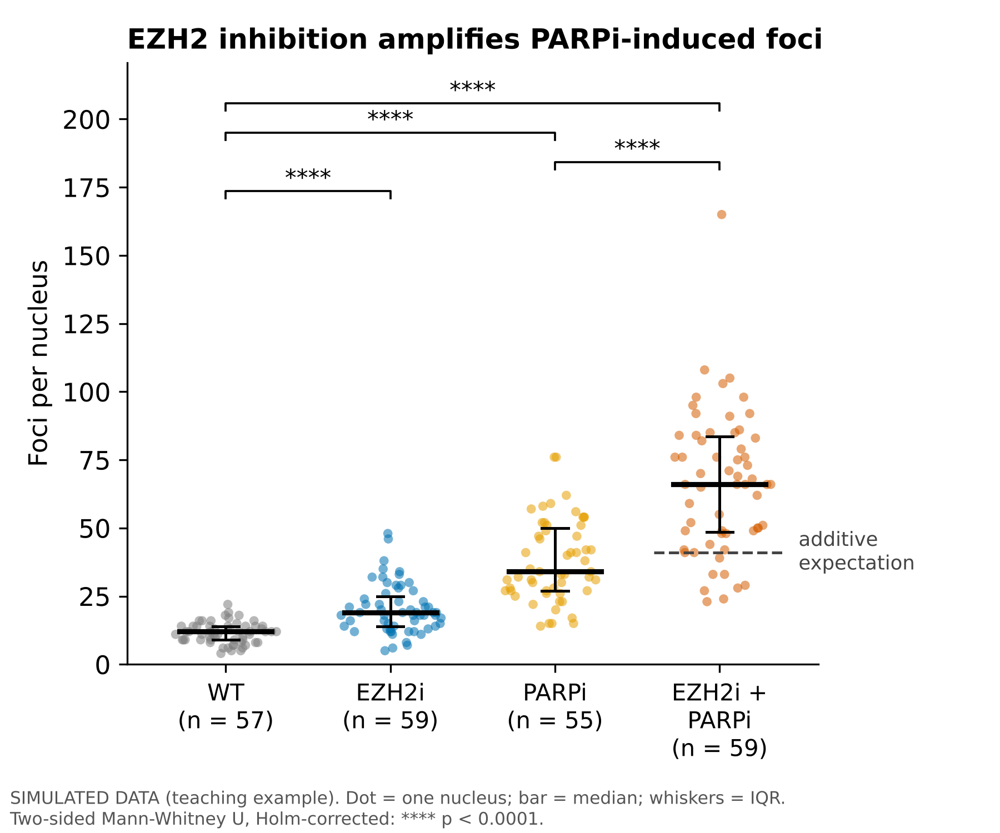

# foci-plot

Week 6 data-visualization example (PSYC 46050): foci per nucleus across four
drug treatments, plotted with Python.



> **The data are simulated.** `data/simulated_foci_counts.csv` was generated by
> `scripts/make_simulated_data.py` to look like a typical DNA damage foci
> experiment. It is a teaching example, not a real measurement.

## Message

Each inhibitor alone raises DNA damage foci above wild type. The combination
raises them far more, above the "additive expectation" (dashed line) of
WT + EZH2i effect + PARPi effect. So in this example EZH2 inhibition
**amplifies** the effect of PARP inhibition.

## The data

`data/simulated_foci_counts.csv`: one **column per condition** and one **row per
cell**. Each number is the count of foci in one nucleus. Columns have 55-59
cells each, so shorter columns end in empty cells.

| Condition | Meaning | Target mean |
|---|---|---|
| WT | untreated wild type | ~10 |
| EZH2i | EZH2 inhibitor | ~20 |
| PARPi | PARP inhibitor | ~35 |
| EZH2i + PARPi | both drugs | ~60 |

Counts are drawn from a negative binomial distribution (whole numbers that spread
out more as the mean grows, like real foci counts) with a fixed random seed, so
re-running the script gives exactly the same file.

## How to run

```bash
git clone https://github.com/eviguls/foci-plot.git
cd foci-plot
conda env create -f environment.yml      # or: pip install -r requirements.txt
conda activate foci-plot
python plot_foci.py                      # makes figures/foci_per_nucleus.png and .pdf
```

Plot your own table (same layout: one column per condition, one row per cell):

```bash
python plot_foci.py path/to/my_counts.csv
```

Regenerate the simulated data: `python scripts/make_simulated_data.py`

## How the plot is built (`plot_foci.py`)

| Element | Why |
|---|---|
| Every cell is a dot, spread sideways by data density ("sina" plot) | Shows all the data and its shape, not just an average |
| Black bar = median, whiskers = interquartile range | Foci counts are skewed; median/IQR are not pulled by a few extreme cells |
| n under each label | Reader knows how many cells each condition has |
| Dashed "additive expectation" line | Turns "the combo is higher" into "the combo is higher than the drugs added together" |
| Mann-Whitney U tests, Holm-corrected | Non-parametric (no normality assumption); correction because 4 tests are made |
| Colour-blind-safe (Okabe-Ito) palette, no top/right box, PNG 300 dpi + vector PDF | Readable on slides and in print |

Caveat: each cell is treated as independent. In a real experiment, use biological
replicates (e.g. 3 independent experiments) as the unit for statistics.
